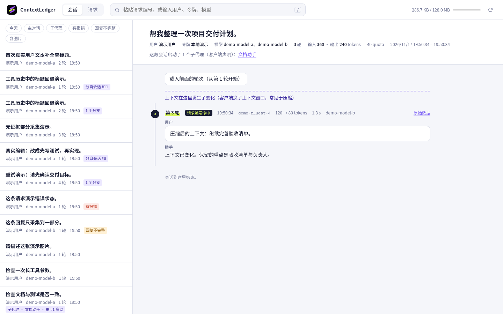

# ContextLedger

给 [new-api](https://github.com/QuantumNous/new-api) 用的对话记录本。

new-api 自带的日志只记「谁、什么时候、用了多少 token」，不记聊了什么。ContextLedger 把每次请求和回复的内容存下来，管理员可以在网页上翻看：用户发了什么，模型回了什么。

## 由两部分组成

- **插件**（[plugins/ca11back_contextledger/plugin.js](plugins/ca11back_contextledger/plugin.js)）：装在 new-api 里。每次请求结束，它把内容整理一下，发给记录服务。
- **记录服务**：一个独立的小程序，负责收、存，并提供一个只有管理员能登录的网页。

## 存哪些内容

插件会先把内容精简一下，只留人看得懂、有审计价值的部分：

- **加密字段不存**。像 `encrypted_content` 这种，人看不懂，也没法审计。
- **Responses 流式回复优先存最终结果**。只要能验证最终回复覆盖了中间片段，就保存最终版；无法验证时保留收到的事件。其他协议的流式内容在网页读取时拼接展示。
- **图片不存原图**。new-api 自己会把图片换成 `[media:N]` 这样的占位符。

## 大对话怎么传

长对话每次请求都会把之前的聊天记录整个带上，越聊越大。如果每次都整个重传，既慢又占空间。所以：

1. 插件先把内容切成小块，给每块算一个「指纹」，然后只把指纹清单发过去。
2. 记录服务对照一下，回复「这几块我还没有」。
3. 插件只补传缺的那几块。

聊得越久，之前的内容大多已经存过，每次要补传的就越少。相同的内容在库里也只存一份，再用 zstd 压缩。

**关于大小限制**：不是说一条记录最大只能 1 MiB。new-api 限制插件每次请求最多发 4 次 HTTP 请求，每次最多 1 MiB。所以插件每次最多先发 1 次清单，再补传 3 批内容，也就是一次最多补传约 3 MiB 的**新**内容。

如果一段全新的对话一上来就超过这个量，这次只能先传一部分，网页上会标成「没传完」。同一段对话的下一次请求会接着补，补齐了就自动变成完整记录。没传完的记录最多保留 1 小时，期间一直没人补齐就作废。

## 可能漏记的情况

- new-api 本身最多只截取约 1 MiB 的回复内容交给插件。这是 new-api 的限制，超出的部分插件拿不到，跟上面说的上传方式无关。
- 网关太忙、重启或者网络出错时，个别请求可能漏记。
- 存下来的是插件整理后发过来的内容，不是网关上原始的网络数据。

没传完的记录会单独列出来，不会冒充完整记录。

## 网页怎么看

网页默认按会话阅读，也可以切到请求列表，或粘贴 new-api 的请求编号直接定位。

- Codex 请求体带有线程声明时，同一线程的上下文压缩会保留在原线程组里，并标记上下文变化；内容分叉单独展示来源。
- 客户端明确声明的子代理会显示父线程和名称，不从聊天内容猜测代理关系。
- 其他客户端按可验证的内容前缀连接；无法确定时另开会话，因此可能出现断开的记录。
- OpenAI Chat、Responses、Claude 和 Gemini 的可识别回复显示为消息、工具调用和工具结果。不完整或异常的回复会单独标记。
- 每轮的「原始数据」可以分段查看实际存下来的内容。图片只显示占位或描述，日志里的远程资源不会自动加载。
- 失败或被重试取代的轮次默认收起成一行；连续的空思考记录合并成一行。

以下截图全部使用虚构的演示数据。

**会话阅读**：左侧会话列表，右侧按轮次阅读。竖线上的支线是内容分叉，失败后被重试的轮次收起成一行。


**按请求编号定位**：粘贴请求编号直接跳到那一轮并高亮，上方标出上下文发生变化的位置。



**请求列表**：按单条请求排查，图片只显示遮罩占位，不加载远程资源。


## 空间管理

设一个总容量上限，比如 10 GB。快满了就从最旧的记录开始删，不用手动清理。

## 本地运行

需要 [Bun](https://bun.sh) 1.4.4。

```sh
bun install --frozen-lockfile
bun run check   # 代码检查、类型检查、测试、构建，一次跑完
```

新建一个 `.env` 文件，不要提交到仓库。密码和令牌自己生成，两个不能一样：

```text
LEDGER_SOURCE=my-gateway                # 数据来源名，随便起
LEDGER_MAX_STORAGE_MB=10000             # 容量上限，10000 MB 就是 10 GB
LEDGER_ADMIN_PASSWORD=<至少 16 个字符>   # 登录网页用
LEDGER_INGEST_TOKEN=<至少 24 个字符>     # 插件上传用
LEDGER_HOST=127.0.0.1
PORT=3000
```

启动：

```sh
bun --env-file=.env run start
```

浏览器打开 `http://127.0.0.1:3000/`，用户名 `admin`，密码就是上面设的那个。

网页没考虑直接放到公网上，建议只在本机监听。要远程访问，可以用 SSH 端口转发。

## 接到 new-api 上

1. 用现成的 Docker 镜像部署记录服务，放进 new-api 所在的 Docker 网络。步骤见 [deploy/README.md](deploy/README.md) 的「快速开始」。
2. 在 new-api 后台从插件市场安装 ContextLedger；也可以在「插件」页面直接上传 [plugins/ca11back_contextledger/plugin.js](plugins/ca11back_contextledger/plugin.js)，同目录的 `icon.png` 作为图标。
3. 新建一个请求处理实例，填三项：
   - `url`：记录服务的接收地址，例如 `http://contextledger:3000/api/ingest`
   - `token`：上面设的 `LEDGER_INGEST_TOKEN`
   - `source`：和上面的 `LEDGER_SOURCE` 填一样的
4. 启用实例。之后有请求经过，刷新记录服务的网页就能看到。

插件 key 是 `ca11back_contextledger`，版本 0.3.0，配合服务端 0.3.0 使用。插件目录里还有给 new-api 插件市场用的 [说明](plugins/ca11back_contextledger/README.zh-CN.md) 和 [更新日志](plugins/ca11back_contextledger/CHANGELOG.zh-CN.md)。

## 更多

Docker 部署、升级和回滚、备份、全部配置项，都在 [deploy/README.md](deploy/README.md)。

技术栈：Bun、TanStack Start、React、Rsbuild、SQLite、zstd。

发版：服务端打 `vX.Y.Z` tag 后，GitHub 自动构建镜像发到 GHCR；插件按 [new-api 官方插件约定](https://docs.newapi.ai/en/docs/plugins/development)发布，tag 是 `plugins/ca11back_contextledger/vX.Y.Z`。两边都要升级时，先发服务端，再发插件。

## 许可证

[MIT License](LICENSE) · Copyright (c) 2026 Ca11back
