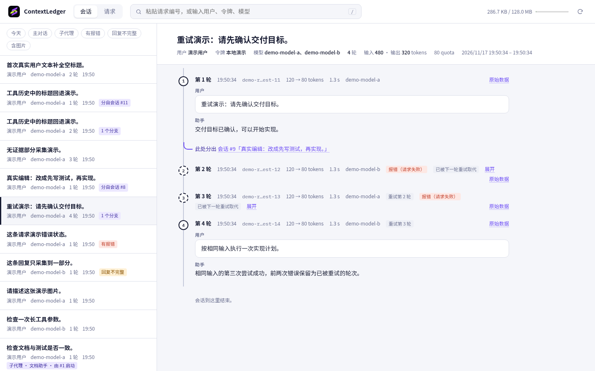
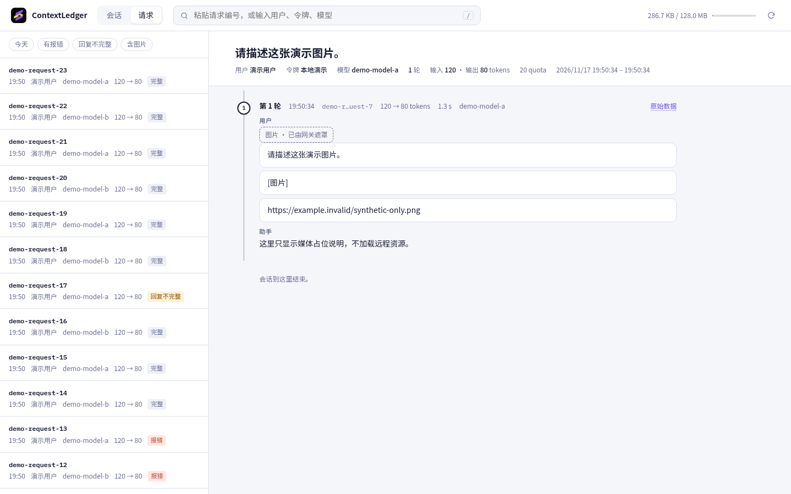

# ContextLedger

面向 [new-api](https://github.com/QuantumNous/new-api) 的自托管对话审计与上下文归档系统。

new-api 原生日志仅记录调用元数据（用户、时间、模型与 token 消耗），不保存实际交互内容。ContextLedger 在网关请求结束时捕获并整理完整的请求与回复，经内容寻址去重与压缩后归档至本地 SQLite，提供仅供管理员访问的会话级审计界面。



> 文中界面截图均基于虚构演示数据生成。

## 架构概览

ContextLedger 由采集插件与独立记录服务两部分协作运行，客户端无需做任何改动：

| 组件 | 位置 / 交付物 | 职责 |
| :--- | :--- | :--- |
| **采集插件** | [plugins/ca11back\_contextledger/plugin.js](plugins/ca11back_contextledger/plugin.js) | 安装于 new-api 内（插件 key 为 `ca11back_contextledger`，v0.3.0），在请求完成后清洗不可审计字段，以分块增量协议推送至服务端。 |
| **记录服务** | `ghcr.io/ca11back/contextledger:0.3`（`amd64` / `arm64`） | 独立的单进程服务（v0.3.0），负责鉴权接收、分块去重与 zstd 压缩落库、会话拓扑还原、容量配额淘汰以及管理员 Web 控制台。 |

## 核心特性

### 审计阅读与会话还原

控制台默认以**会话视角**呈现记录，同时支持切换为**单条请求列表**，或直接粘贴 new-api 的 **Request ID** 精确定位到对应轮次，并按用户、令牌、模型及状态（主对话、子代理、报错、回复不完整、含图片）快速筛选。

- **多协议结构化解析**：识别 OpenAI Chat、OpenAI Responses、Claude 与 Gemini 协议，将消息正文、工具调用与工具返回渲染为结构化视图，异常或残缺回复独立标注。
- **确定性线程、分叉与子代理关联**：
  - 对携带显式线程声明的 Codex 请求，同一线程内的上下文压缩仍归属原线程并标出变化位置，内容分叉独立展示来源分支。
  - 对客户端明确声明的子代理，关联展示父线程与代理名称，不基于对话文本做启发式猜测。
  - 其他客户端按可验证的内容前缀串联会话；前缀无法确认时另起新会话，宁可断开也不误拼。
- **阅读降噪与原始核验**：失败或已被后续重试取代的轮次默认折叠为单行，连续空思考自动合并；每轮均可按段展开「原始数据」核对落库原文。图片仅展示占位符或描述，不会自动加载日志中的外部远程资源。

**按请求编号定位**：粘贴 Request ID 直达目标轮次并高亮显示，同时标出上下文发生变化的节点。


**单条请求排查**：按请求维度逐条检视详情，图片仅显示遮罩占位，杜绝外链资源自动加载。



### 增量分块传输与去重存储

长对话在每轮请求中都会重复携带历史上下文，直接全量上报既耗带宽又占磁盘。ContextLedger 采用内容寻址机制解决这一问题：

1. **采集端精简**：剔除 `encrypted_content` 等无法人工审计的加密字段；OpenAI Responses 流式响应在可验证终态完整覆盖中间事件时仅保留最终结果（无法验证则保留完整事件流），其他协议流式内容在阅读时拼接还原；图片已由 new-api 替换为 `[media:N]` 占位符，不存原图；不采集插件配置、请求头与 Embedding 请求（`format=embedding`）。
2. **指纹协商与差量补传**：插件将内容切片并计算 SHA-256 指纹清单先行上报，服务端比对后仅返回缺失块列表，插件只需补传新增分块。对话越长，单轮增量越小。
3. **全局去重与自动配额淘汰**：相同内容块在 SQLite 中仅存一份并经 `zstd` 压缩。通过 `LEDGER_MAX_STORAGE_MB` 设定数据库容量上限（例如 `10000` 即 10 GB），逼近阈值时自动从最旧记录开始淘汰，无需人工维护；亦可选配 `LEDGER_MAX_AGE_DAYS` 限定最长保留天数。

> **关于单次传输上限**：new-api 限制插件单次请求最多发起 4 次 HTTP 调用、每次上限 1 MiB。借助指纹协商，插件以「1 次清单 + 最多 3 批分块」的方式，单次可补传约 **3 MiB 的新增内容**（而非整条记录上限 1 MiB）。若全新超长对话单次未能传完，系统会将其标记为「未完整采集」，由同一对话的后续请求继续补齐；超过 1 小时仍未补齐的残缺记录会自动作废。

## 快速接入（推荐 Docker 部署）

生产环境建议将 ContextLedger 与 new-api 置于同一 Docker 网络内，通过内网地址通信。完整的镜像标签说明、升级与回滚、热/冷备份及全量配置项请参阅 [部署与运维文档](deploy/README.md)。

1. **部署记录服务**：参考 [deploy/README.md](deploy/README.md) 中的快速开始步骤，准备 `ledger.env`（权限设为 `0600`）并使用镜像 `ghcr.io/ca11back/contextledger:0.3` 启动容器。
2. **安装 new-api 插件**：在 new-api 后台插件市场搜索并安装 ContextLedger；或前往「插件」页面手动上传 [plugins/ca11back\_contextledger/plugin.js](plugins/ca11back_contextledger/plugin.js) 与同目录的 `icon.png`（已在 new-api `v1.0.0-rc.51` 验证）。
3. **配置请求处理实例**：新建实例并填写以下三项配置，按需设定生效范围后启用：

| 插件配置项 | 说明 | 示例 |
| :--- | :--- | :--- |
| `url` | 记录服务接收地址 | `http://contextledger:3000/api/ingest` |
| `token` | 与服务端一致的 `LEDGER_INGEST_TOKEN` | 至少 24 位随机字符串 |
| `source` | 与服务端一致的 `LEDGER_SOURCE` | `new-api` |

4. **访问审计台**：在宿主机打开映射端口（或通过 SSH 端口转发到本地），使用默认账号 `admin` 及 `LEDGER_ADMIN_PASSWORD` 登录。

插件面向 new-api 市场的独立说明与变更记录见 [plugins/ca11back\_contextledger/README.zh-CN.md](plugins/ca11back_contextledger/README.zh-CN.md) 与 [CHANGELOG.zh-CN.md](plugins/ca11back_contextledger/CHANGELOG.zh-CN.md)。

## 本地开发与运行

运行环境需要 [Bun](https://bun.sh) `1.4.4`。

```sh
bun install --frozen-lockfile
bun run check   # 依次执行代码检查、类型检查、单元测试、构建与客户端边界审计
```

在项目根目录创建 `.env`（切勿提交至版本库），确保管理员密码与上传令牌彼此不同：

```dotenv
LEDGER_SOURCE=my-gateway                # 数据来源标识，需与插件配置一致
LEDGER_MAX_STORAGE_MB=10000             # 数据库容量上限（十进制 MB，10000 = 10 GB）
LEDGER_ADMIN_PASSWORD=<至少 16 个字符>   # 控制台登录密码
LEDGER_INGEST_TOKEN=<至少 24 个字符>     # 插件上传鉴权令牌
LEDGER_HOST=127.0.0.1
PORT=3000
```

启动服务：

```sh
bun --env-file=.env run start
```

访问 `http://127.0.0.1:3000/`，默认用户名为 `admin`，密码为 `LEDGER_ADMIN_PASSWORD`。

## 已知边界与安全提示

- **上游截断上限**：new-api 传递给插件的响应体上限约为 1 MiB，超出部分插件侧无法获取，与 ContextLedger 的分块上传机制无关。
- **弱一致采集边界**：当网关过载、重启或网络异常时，个别请求可能漏记。所有未传完的记录都会单独标识，绝不冒充完整记录。
- **非原始抓包**：落库内容是插件清洗整理后的可读审计视图，不等同于网关层的原始网络报文。
- **访问与数据安全**：数据库与备份包含完整对话内容（可能涉及用户隐私或敏感凭据），请严格收紧宿主机目录权限并告知用户。控制台默认设计为仅本机监听，不建议直接暴露至公网；远程访问请使用 SSH 端口转发，或在反向代理层自行配置 HTTPS 与额外访问控制。
- **单进程约束**：同一 SQLite 数据库文件仅允许单个服务进程挂载，升级或维护时需先停止旧实例。

## 技术栈与发版约定

- **技术栈**：Bun · TanStack Start · React · Rsbuild · SQLite · zstd
- **发版流程**：
  - 服务端推送 `vX.Y.Z` tag 后，由 GitHub Actions 自动构建并发布多架构镜像至 GHCR。
  - 插件遵循 [new-api 官方插件约定](https://docs.newapi.ai/en/docs/plugins/development)发布，对应 tag 为 `plugins/ca11back_contextledger/vX.Y.Z`。
  - 双端同时升级时，务必**先升级服务端，再升级插件**。

## 许可证

[MIT License](LICENSE) · Copyright (c) 2026 Ca11back
